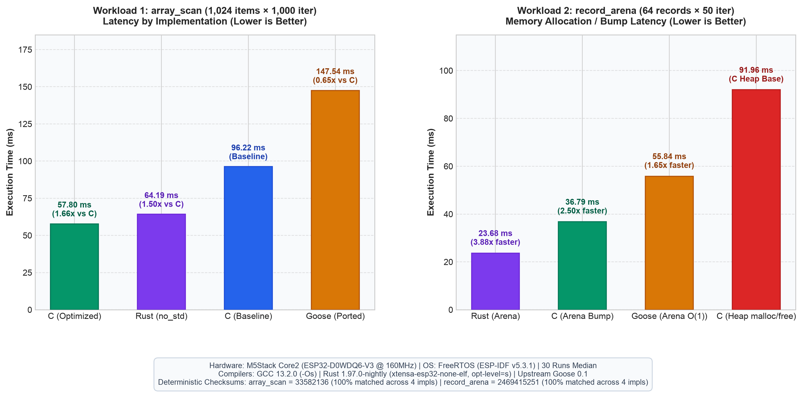

# Goose on M5Stack Core2

Experimental port of [Goose](https://github.com/aardappel/goose) to M5Stack Core2 (ESP32 Xtensa LX6) using ESP-IDF.

**Status: Experimental port. C baseline, C optimized, Rust (`no_std`), and Goose-generated firmware have been verified and benchmarked on physical Core2 hardware.**

## Architecture

Host Goose compiler → generated C + ESP-IDF FreeRTOS/PSRAM runtime → ESP-IDF Xtensa toolchain → Core2.  
Rust benchmark module (`benchmarks/rust`) → `xtensa-esp32-none-elf` LLVM release object (`rust_bench.o`) → ESP-IDF CMake link.

## Milestone Status

1. [x] Build Goose compiler on host and generate C from minimal and benchmark programs ([Issue #1](https://github.com/nurupoga/goose-core2/issues/1)).
2. [x] Audit generated C and runtime for POSIX, virtual memory, pointer width and threading dependencies ([Issue #2](https://github.com/nurupoga/goose-core2/issues/2)).
3. [x] Compile generated C using ESP-IDF (ESP32 Xtensa target) ([Issue #2](https://github.com/nurupoga/goose-core2/issues/2)).
4. [x] Implement bounded PSRAM-backed stack allocation and FreeRTOS runtime port ([Issue #3](https://github.com/nurupoga/goose-core2/issues/3), [Issue #4](https://github.com/nurupoga/goose-core2/issues/4)).
5. [x] Execute Goose-originated arithmetic on physical Core2 and report deterministic result over UART ([Issue #5](https://github.com/nurupoga/goose-core2/issues/5)).
6. [x] Benchmark C vs C-Opt vs Rust vs Goose on Core2 hardware ([Issue #6](https://github.com/nurupoga/goose-core2/issues/6), [Issue #7](https://github.com/nurupoga/goose-core2/issues/7)).

## Baseline & Benchmark Run

Install ESP-IDF and Rust Xtensa (`espup`), then run:

```sh
# Build Rust benchmark component
cd benchmarks/rust
cargo +esp build --target xtensa-esp32-none-elf -Zbuild-std=core --release
cd ../..

# Build & Flash ESP-IDF application
idf.py build
idf.py -p /dev/ttyUSB0 flash monitor
```

### Benchmark Results (Physical Core2 Hardware)

Measurements captured from physical M5Stack Core2 hardware across 30 repeated warm runs each (240 runs total across all workloads and implementations) ([Issue #7](https://github.com/nurupoga/goose-core2/issues/7), [Issue #6](https://github.com/nurupoga/goose-core2/issues/6)).



#### Workload 1: `array_scan` (1,024 elements × 1,000 inner iterations)
Arithmetic and linear memory traversal.

| Implementation | Status | Samples | Median (μs) | P95 (μs) | Min (μs) | Max (μs) | Speedup vs C Base | Checksum | Free PSRAM |
|---|---|---|---|---|---|---|---|---|---|
| **C (Optimized)** | **Verified on Core2** | 30 | **57,805.0** | 57,805 | 57,805 | 57,817 | **1.66x** | `33582136` | 4,191,744 B |
| **Rust (`no_std`)** | **Verified on Core2** | 30 | **64,188.0** | 64,188 | 64,188 | 64,189 | **1.50x** | `33582136` | 2,094,588 B |
| **C (Baseline)** | **Verified on Core2** | 30 | **96,225.0** | 96,225 | 96,225 | 96,230 | 1.00x (base) | `33582136` | 4,191,744 B |
| **Goose (Ported Runtime)** | **Verified on Core2** | 30 | **147,543.0** | 147,543 | 147,543 | 147,547 | 0.65x | `33582136` | 2,094,588 B |

#### Workload 2: `record_arena` (64 records × 50 inner iterations)
Dynamic payload allocation, field aggregation, and memory reclaim.

| Implementation | Status | Samples | Median (μs) | P95 (μs) | Min (μs) | Max (μs) | Speedup vs C Heap | Checksum | Free PSRAM |
|---|---|---|---|---|---|---|---|---|---|
| **Rust (Arena Bump)** | **Verified on Core2** | 30 | **23,683.0** | 23,683 | 23,683 | 23,715 | **3.88x faster** | `2469415251` | 521,716 B |
| **C (Arena Bump)** | **Verified on Core2** | 30 | **36,788.0** | 36,792 | 36,784 | 36,813 | **2.50x faster** | `2469415251` | 2,094,588 B |
| **Goose (Arena O(1))** | **Verified on Core2** | 30 | **55,837.0** | 55,837 | 55,837 | 56,153 | **1.65x faster** | `2469415251` | 521,716 B |
| **C (Heap malloc/free)** | **Verified on Core2** | 30 | **91,964.0** | 91,964 | 91,964 | 92,006 | 1.00x (base) | `2469415251` | 2,094,588 B |

### Key Findings & Analysis

1. **Deterministic Checksum Parity**:
   - `array_scan`: `33582136` (100% identical across all 120 samples of C, C-Opt, Rust, and Goose).
   - `record_arena`: `2469415251` (100% identical across all 120 samples of C-Heap, C-Arena, Rust, and Goose).
2. **Goose Arena Allocation Advantage**:
   - In dynamic allocation workloads (`record_arena`), Goose's stack-based bump pointer and $O(1)$ stack rewind (`GS(gs_sp)->top = base`) runs in **55.84 ms**, significantly outperforming standard C heap dynamic allocation (`malloc`/`free`: **91.96 ms**) by **1.65x**.
3. **Linear Compute Characteristics**:
   - In purely arithmetic/array operations (`array_scan`), C Optimized (**57.81 ms**) and Rust (**64.19 ms**) achieve top speeds.
   - Goose (**147.54 ms**) runs slower in `array_scan` because Goose defaults to 64-bit integer semantics (`int64_t`), requiring multi-register emulation on the 32-bit Xtensa CPU, alongside stack overflow boundary checks.
4. **Rust Performance**:
   - Rust (`no_std` on Xtensa LLVM) achieves outstanding efficiency, winning the `record_arena` test (**23.68 ms**, 3.88x faster than C malloc/free) due to aggressive loop optimization and zero-overhead memory layouts.

### Hardware & Environment Details

- **Device**: M5Stack Core2
  - SoC: ESP32-D0WDQ6-V3 (revision v3.1) @ 160MHz
  - Internal RAM: ~313 KB available heap
  - PSRAM: 8MB physical / 4MB mapped cache
  - Port: `/dev/cu.usbserial-567F0187701`, MAC: `b0:b2:1c:60:7c:24`
- **Operating System**: FreeRTOS (ESP-IDF v5.3.1)
- **Compilers**:
  - C / Goose Runtime: `xtensa-esp-elf-gcc` 13.2.0 (`-Os` size optimization)
  - Rust: `rustc 1.97.0-nightly` (`xtensa-esp32-none-elf`, `opt-level = "s"`, `-Zbuild-std=core`)
  - Goose: Upstream compiler commit `e8d2543`
- **Raw Artifacts**: 
  - Complete UART capture log: [`benchmarks/results/raw_core2.log`](benchmarks/results/raw_core2.log)
  - Summary metrics CSV: [`benchmarks/results/benchmark-summary.csv`](benchmarks/results/benchmark-summary.csv)
  - Visualization chart: [`benchmarks/results/benchmark_results.png`](benchmarks/results/benchmark_results.png)

## Upstream

https://github.com/aardappel/goose

Independent experimental project; not an official upstream target.
